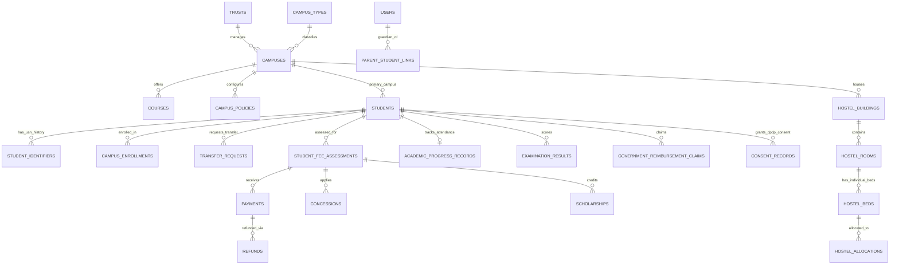

# TrustOS — AI-Powered Multi-Campus Educational Trust Management Platform

> **Synthetic Demonstration Notice**: All 14,000 canonical students, 6 campuses, financial transactions, attendance records, examination results, and government reimbursement claims generated in this workspace are **synthetic demonstration data**. No real student or minor PII is used.

---

## 1. Architecture & Core Capabilities

- **One Permanent Student Identity (`students.student_id` UUID)** across all 6 campuses (`VVE-BLR`, `VVE-MYS`, `VVP-HBL`, `VVP-MLR`, `VVS-BGV`, `VVS-TMK`). Campus transfers preserve `student_id`, mark the previous enrollment as `TRANSFERRED`, retain the old USN in `student_identifiers`, and issue a collision-safe destination USN via PostgreSQL sequences.
- **PostgreSQL 18 Row-Level Security (RLS)** enforced under the restricted `trustos_app` role (`NOSUPERUSER`, `NOBYPASSRLS`) using transaction-local `SET LOCAL app.current_*` variables so connection pooling never leaks identity context.
- **Two-Level Fee Verification & Immutable Receipts**: Payments pass through College Verification and Trust Reconciliation before becoming `POSTED`. Database trigger `trg_posted_payment_immutability` blocks editing or deleting posted payments; corrections require linked Refunds or Reversals.
- **Visual Hostel Vacancy Map & Transactional Bed Allocation**: Tracks individual beds (`AVAILABLE`, `OCCUPIED`, `RESERVED`, `OUT_OF_SERVICE`) separately from room counts and uses `SELECT ... FOR UPDATE` row locking to prevent concurrent double-allocation.
- **Multi-Dataset Ingestion & AI/Heuristic Identity Reconciliation**: Profiles and maps CSV, XLSX, JSON, and safe regex-parsed SQL dumps. Evaluates duplicate candidates against ground truth (`Precision = 100%`, `Recall = 100%`, `F1 = 100%`, `0 False Positives` on homonyms vs. `60% Precision` for naive name-only baseline).
- **DPDP Act, 2023 & Rules, 2025 Engineering Controls**: Versioned privacy notices, purpose-specific consent grant/withdrawal, minor guardian verification checks, statutory financial ledger retention holds, and append-only `audit_logs` protected by database trigger `trg_protect_audit_logs`.

---

## 2. Database Entity-Relationship (ER) Diagram



---

## 3. Exact Setup, Run, Test & Reset Instructions

### Step 1: Initialize & Start PostgreSQL 18 (Port 5433)
```powershell
# Start the local PostgreSQL 18 cluster
& "C:\Program Files\PostgreSQL\18\bin\pg_ctl.exe" -D "C:\Users\Aman Singh\.gemini\antigravity\scratch\trustos\pgdata" -l "C:\Users\Aman Singh\.gemini\antigravity\scratch\trustos\pgdata\postgres.log" start

# Apply Schema, Restricted Role (trustos_app), Triggers & RLS Policies
& "C:\Program Files\PostgreSQL\18\bin\psql.exe" -h 127.0.0.1 -p 5433 -U postgres -d trustos_db -f "C:\Users\Aman Singh\.gemini\antigravity\scratch\trustos\backend\sql\001_schema_and_rls.sql"
```

### Step 2: Generate Deterministic 14,000-Student Canonical Dataset & Imperfect Raw Files
```powershell
$env:PYTHONPATH="C:\Users\Aman Singh\.gemini\antigravity\scratch\trustos\backend"
python -m app.seed_and_synthetic
```

### Step 3: Run Automated Pytest Acceptance Suite (Sections 21.A – 21.I)
```powershell
$env:PYTHONPATH="C:\Users\Aman Singh\.gemini\antigravity\scratch\trustos\backend"
python -m pytest "C:\Users\Aman Singh\.gemini\antigravity\scratch\trustos\backend\tests\test_trustos_acceptance.py" -v
```

### Step 4: Start Backend (FastAPI on Port 8000) & Frontend (Vite React on Port 5173)
```powershell
# Terminal 1: FastAPI Backend
$env:PYTHONPATH="C:\Users\Aman Singh\.gemini\antigravity\scratch\trustos\backend"
python -m uvicorn app.main:app --host 127.0.0.1 --port 8000

# Terminal 2: React + TypeScript Frontend
cd "C:\Users\Aman Singh\.gemini\antigravity\scratch\trustos\frontend"
npm install
npm run dev
```

### Development Demo Accounts (Password for all active demo accounts: `TrustOS@2026`)
| User ID | Role | Scope |
| :--- | :--- | :--- |
| `M1001` | Trust Management | All 6 Campuses + Cumulative Deduplicated View |
| `A1001` .. `A1006` | College Administrator | Scoped strictly to Campus 1 .. Campus 6 via RLS |
| `W1001` .. `W1006` | Hostel Warden | Scoped to Campus 1 .. 6 Hostels (No financial access) |
| `S10001` .. `S10006` | Student | Own Student Record Only |
| `P10001` .. `P10006` | Parent / Guardian | Verified Linked Student Record Only |
| `A1099` / `A1098` | Pending / Suspended | Blocked from login (Security Verification) |
